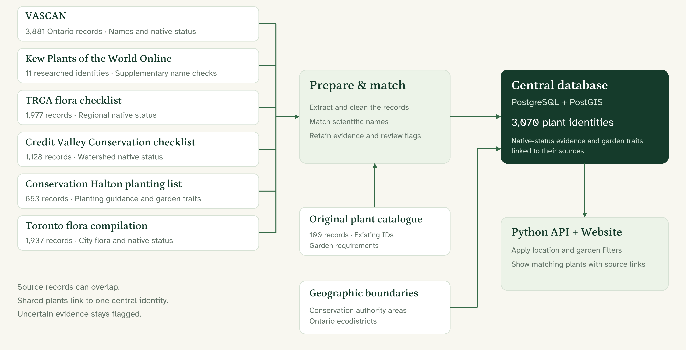

# Data pipeline

PostgreSQL/PostGIS is the operational database. SQLite is used for source preparation and staging; the website reads PostgreSQL through a read-only account.

## Source datasets

The diagram uses counts from the project snapshots. Source records can overlap, and the central identity count includes records awaiting review. Regional boundaries describe source coverage rather than exact plant ranges. The app applies native-status and garden-condition filters when selecting results.

## Layout

- Outer dependencies/source-data/: original archives, PDFs and original 100-plant SQLite input.
- Outer dependencies/: optional portable PostgreSQL and Python packages.
- Outer local/: private credentials; never commit.
- Outer work/: extraction audits, excluded records, prepared boundaries and backups.
- Project data/regional/: source registry and locally generated PDF records.
- Project data/identity/: manually reviewed VASCAN/Kew links.
- Project data/native-only/: source-specific native and review subsets, with manifests.
- Project data/database/: Git-ignored staging SQLite databases.
- Project data/central/: tracked schema and reports; Git-ignored bulk load SQL.

## Processing order

1. Acquire exact source snapshots using the registries and confirm their permitted use.
2. Restore the original plants.db and reviewed identity crosswalk inputs. These are not reconstructed automatically from a fresh clone.
3. Run build_regional_datasets.py to extract the three regional PDFs.
4. Run build_native_subsets.py to retain separate native, review and excluded decisions for six sources.
5. Run prepare_boundaries.py with GDAL to convert the authority/ecodistrict archives.
6. Run build_central_database.py to create normalized staging data and PostgreSQL load SQL.
7. Load PostgreSQL and provision read-only access.
8. Validate and run the website. See SETUP.md for commands and prerequisites.

Original names, source evidence, uncertainty and original plant IDs are preserved. Identity matches do not prove local nativity; regional evidence and garden compatibility are evaluated separately. No fuzzy matches or ecological-district membership alone establish local native status.

Historical extraction reconciled 151 plant-table pages and retained page/rejection audits outside Git. This was not a complete botanical audit. Halton/Hamilton inventory extents and the Toronto study boundary remain unverified. Source coverage, native status, local occurrence and garden requirements remain separate concepts.

Generated source-derived records stay out of the default public upload pending reuse review. No local payload is deleted by this policy. See ../DATA_SOURCES.md.
