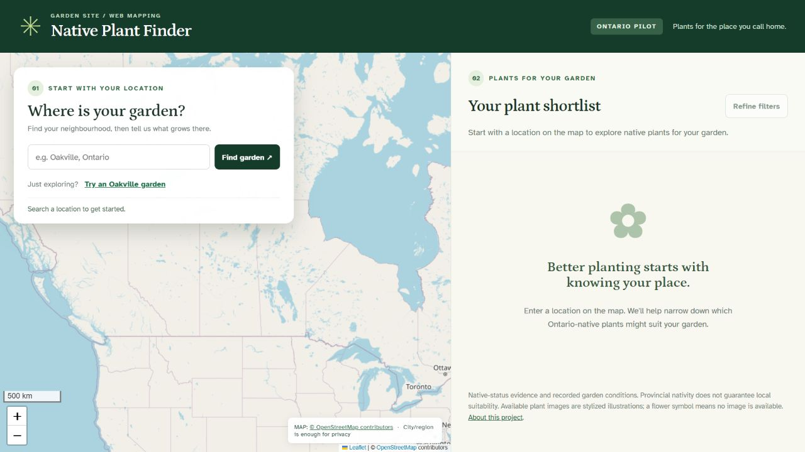
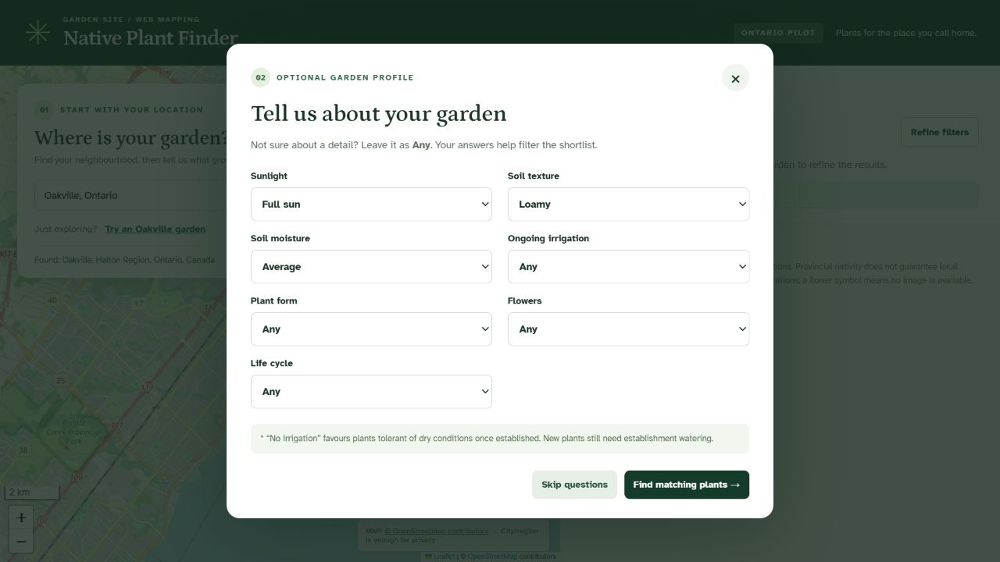
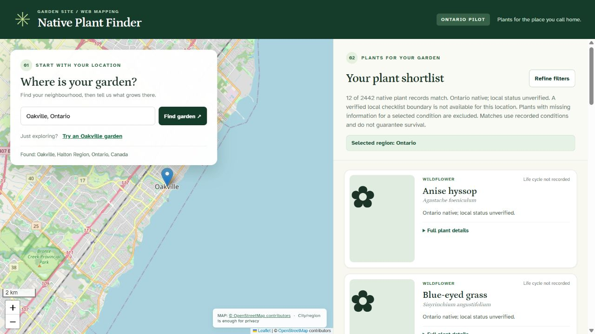

# Interface screenshots

These views show an Oakville city search using full sun, loamy soil and average moisture. Results reflect the database snapshot at capture time.

## Location search

Search for a Canadian location or use the built-in Oakville example.

## Garden conditions

Optional filters narrow the list using recorded sunlight, soil and moisture requirements.

## Plant results

The captured search returns 12 matching records. Results show scientific names and links to native-status sources. For this location, the app uses Ontario-native evidence and labels local status as unverified.

Map attribution is retained in the screenshots. Flower symbols indicate records without an illustration.

[Project overview](../README.md) · [Data pipeline](DATA_PIPELINE.md)
